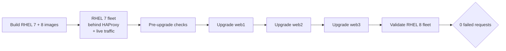

# RHEL 7 to RHEL 8 upgrade

A fleet of three RHEL 7.9 servers behind a load balancer, moved to RHEL 8.10 **one host at a time while users keep using it**.
Ansible orchestrates the rolling upgrade, and Chef configures each new RHEL 8 host. A probe sends a request every 50 ms the whole time and proves none failed.

[Live pipeline →](https://danielkojomegbenu.com/projects/rhel-7-to-8)

## The pipeline



Each host's upgrade, run by `ansible/upgrade.yml`:

1. **Drain** it at HAProxy, so no new requests reach it, and let in-flight ones finish.
2. **Retire** the RHEL 7 host.
3. **Start a RHEL 8 host** under the same name.
4. **Configure it with Chef**: the `webapp` cookbook, run by Cinc in local mode.
5. **Check it directly**: RHEL 8, and its health check answers.
6. **Put it back in the pool**, and wait until HAProxy's health checks pass.

Only one host is ever out, so two of three are always serving.

| Step | What happens | Fails the run when |
|---|---|---|
| Pre-upgrade checks | Like Red Hat's Leapp report: on 7.9, enough disk, no packages that RHEL 8 removed. It also finds what must change (the portal runs on **Python 2, which RHEL 8 doesn't ship**) and records how each host behaves | A host isn't ready |
| Upgrade web1, web2, web3 | The six steps above, one host at a time | A new host doesn't come up, configure or pass its checks |
| Validate | Every host is on RHEL 8 and behaves **exactly** as it did on RHEL 7: same health check, same page, same `Server` header, enabled at boot | Anything differs |
| Zero-downtime check | The probe stops and reports | Any request failed |

## Who does what

| Tool | Job |
|---|---|
| **Ansible** | Orchestration: the order, draining and restoring hosts at HAProxy, the checks before and after |
| **Chef** (Cinc) | Configuration: installs Python 3, deploys the portal and its systemd unit, and starts it |
| **HAProxy** | Keeps users on healthy hosts. Its runtime API is how Ansible drains a host |

## The real RHEL 7 to 8 change this handles

The orders portal (`app/portal.py`) ran on Python 2.7. RHEL 8 has no Python 2 by default, so the code was made to run on both, and the Chef recipe runs it on Python 3 on RHEL 8. The pre-upgrade check finds every service still on Python 2.

The servers are Red Hat's own Universal Base Images, so the RHEL 7.9 and RHEL 8.10 packages are genuine. RHEL 8 hosts run systemd. RHEL 7's systemd (v219) can't run on today's cgroup v2 hosts, so in CI the RHEL 7 portal runs as the container's main process, with its unit file still installed and enabled.

## See a shortcut cause downtime

Open the pull request **demo/no-drain**. It skips draining: hosts are swapped while HAProxy is still sending them traffic.
Every host still ends up on RHEL 8 and validates, but users hit the gaps, and the **Zero-downtime check** fails with the requests that failed.

## Run it on your machine

```bash
docker build -t fleet/rhel7:local -f images/rhel7/Dockerfile . && docker build -t fleet/rhel8:local images/rhel8
docker compose up -d && mkdir -p report && python3 scripts/probe.py &
cd ansible && ansible-galaxy collection install -r requirements.yml
ansible-playbook preupgrade.yml
for h in web1 web2 web3; do ansible-playbook upgrade.yml -e host=$h; done
ansible-playbook validate.yml
```

## What's in the repo

| Path | What it is |
|---|---|
| `app/portal.py` | The orders portal (runs on Python 2 and 3) |
| `images/rhel7`, `images/rhel8` | The RHEL 7.9 host as it was, and a clean RHEL 8.10 host with Cinc |
| `haproxy/haproxy.cfg`, `docker-compose.yml` | The load balancer and the RHEL 7 fleet |
| `ansible/` | `preupgrade.yml`, `upgrade.yml` (one host), `validate.yml` |
| `chef/cookbooks/webapp` | The recipe that configures each RHEL 8 host |
| `scripts/probe.py`, `scripts/haproxy.py` | The users, and the HAProxy runtime API helper |
| `.github/workflows/upgrade.yml` | The pipeline |

## Cost

Free. Everything runs on the GitHub runner, and GitHub Actions is free for public repos.
